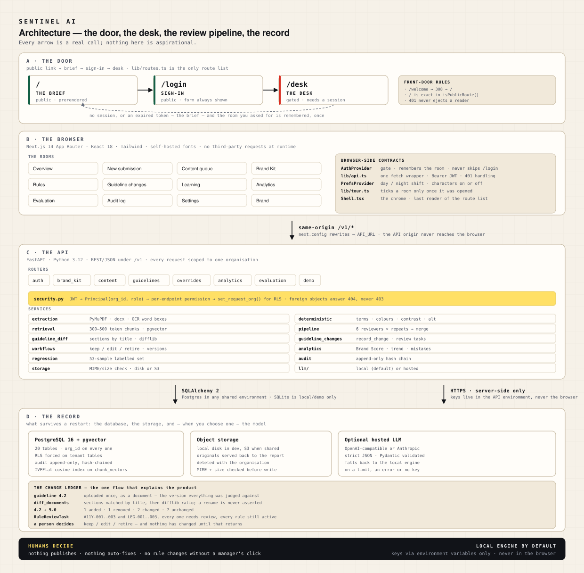

# Architecture



*The source of this diagram is `docs/images/architecture.svg` (a PNG copy sits beside it for
contexts that cannot render SVG). It is drawn from the code, not from ambition: every arrow
is a call that exists, and every number in it is one the seed actually produces.*

This page is the **system** — where things run and how a request moves. For the **people** — who does
what, in what order, and where the gate sits — see [`USER-JOURNEY.md`](USER-JOURNEY.md).

Four layers, top to bottom:

| Layer | What it is | Where it lives |
|---|---|---|
| **A · The door** | the public brief at `/`, the sign-in at `/login`, the desk at `/desk` | `lib/routes.ts`, `lib/auth.tsx`, `next.config.js` |
| **B · The browser** | twelve rooms, one fetch wrapper, two browser-only preferences, the walkthrough | `frontend/app/`, `frontend/lib/` |
| **C · The API** | FastAPI routers, `security.py`, and the services the review is built from | `backend/app/` |
| **D · The record** | Postgres + pgvector, object storage, an optional hosted model | `backend/app/models.py`, `migrations/` |

## Why these boundaries

* **The browser never calls the AI provider or the API origin directly.** Next.js rewrites `/v1/*`, so the
  token is same-origin, CORS is unnecessary, and the API base URL is not baked into client code.
* **One AI adapter interface.** Reviewers are written against `LLMAdapter.review(reviewer, ctx)` returning
  a Pydantic-validated object. Swapping `local` → `openai` changes judgement quality, not plumbing.
* **Deterministic checks bypass the model entirely.** Terms, colours, alt text, contrast and image size are
  computed in `services/deterministic.py` and are unit tested. They are the anchor of every confidence
  score, so a model can never downgrade a factually certain finding.
* **Learning writes versions, never edits.** `services/workflows.promote()` appends a `rule_version` and
  marks the previous one `superseded`; `revert_rule_version()` appends a copy of the old body. History is
  immutable, which is what makes the audit trail meaningful.

## Request lifecycle (analysis)

1. `POST /v1/content/{id}/analyze` verifies ownership/permission, creates an `analysis_run` row
   (`queued`), commits, then schedules `execute_run(run_id)` as a FastAPI background task and returns 202.
2. `execute_run` opens its **own** session (background tasks outlive the request session), sets
   `status=running`, and calls `analyse_text()`.
3. `build_context()` loads the active Brand Kit: rules in scope (category + department/content-type
   filters), confirmed terms and facts, brand assets, and retrieves up to ~16 evidence chunks
   (14 rule-derived queries + the content head) via pgvector.
4. Deterministic candidates are produced first, then `reviewer_candidates()` fans out six reviewers ×
   `LLM_REPEAT_RUNS` on a `ThreadPoolExecutor(6)`. A failing reviewer is logged and skipped; the run
   continues.
5. `merge_findings()` clusters same-reviewer/same-category candidates by span IoU ≥ 0.5, chooses the
   representative (deterministic > severity > span length), computes agreement/evidence/confidence, forces
   `label=confirmed` for deterministic or direct-contradiction clusters, drops suggestions that escape the
   span, and sorts by severity.
6. Findings are persisted with rule id/version, provider, model, prompt version and the score inputs;
   `stats` records counts, duplicates merged, injection scan, duration.
7. `status=complete`, `finished_at` set. On any exception the run is marked `failed` with the error text so
   the UI can explain it instead of hanging.

## Retrieval & chunking

`services/retrieval.chunk_text()` produces 300–500 token, sentence-aligned windows with ~60 token overlap
and never emits a chunk over the maximum (a short tail is merged forward only when it still fits). Each
chunk keeps page number and the last numbered section heading. Embeddings live in `chunks.embedding`
(JSON, portable) and, on Postgres, are mirrored into `chunk_vectors(embedding vector(1536))` with an
IVFFlat cosine index. SQLite falls back to in-process cosine similarity over the same vectors, so
behaviour is identical in tests and demos.

## The door — brief, sign-in, desk

Three routes, one order, enforced in `lib/auth.tsx` against the single route list in
`lib/routes.ts`:

```
/            public, prerendered     the brief: what the committee is, how a review reads
/login       public                 the sign-in form — always shown, never skipped
/desk        gated                  the desk overview; every other room hangs off it
```

* `/` is **exact** in `isPublicRoute()` and everything else is a prefix. A prefix test for
  `/` would be true for every path in the application and would switch the gate off.
* An anonymous visitor who asks for a desk room is sent to the brief, and the room they
  asked for is remembered in `sessionStorage['sentinel.next']` — consumed once, on the
  next successful sign-in. It is not kept in a query string precisely so that neither
  page has to become dynamic.
* **The sign-in is a step, not an obstacle.** It renders for everyone; a browser already
  holding a session sees the form plus *"Signed in as …"* and a *Continue to the desk*
  button. (An earlier convenience redirect skipped the page entirely for returning
  visitors, which meant "Open the workspace" jumped straight to the dashboard and the
  second step of the door never appeared.)
* `/welcome` is a permanent redirect to `/`, so older links keep working.
* A `401` on a public page never ejects the reader — `lib/api.ts` asks `isPublicRoute()`
  before redirecting, so an expired token only costs them the "API online" dot.

## Frontend data flow

* `AuthProvider` holds `/auth/me` (role + permission flags), enforces the door above, and
  renders the desk chrome only on desk routes (`Shell.tsx` reads the same route list).
* Each page loads its own data; the Review Report polls the run every 900 ms while `queued|running`.
* Highlighting works on the server-provided `span_start`/`span_end` character offsets: `DocumentView` cuts the
  text at every span boundary, and where spans overlap the most severe wins visually. Applying a suggestion
  renders an inline tracked change (`<del>`/`<ins>`) in the browser session only — nothing is saved until a
  human records a decision and adds a version.
* Design tokens live once, in `tailwind.config.js` + `app/globals.css` (`--royal-navy`, `--gold`, …). Brand art
  is original inline SVG in `app/components/brand/` (crest, patterns, six reviewer avatars, Sentri the owl,
  seals) — no external requests at runtime. Fonts are committed as latin `.woff2` in `app/fonts/` and loaded
  with `next/font/local` (`app/fonts/OFL-NOTICE.md` has the licences): `next/font/google` fetched them at
  build time, so a build with no egress — or a rate-limited Google response — failed outright. Severity is never colour
  alone: every chip carries a glyph and a word, and highlighted spans carry distinct underline styles.
* `PrefsProvider` stores two browser-only preferences (dark theme, "Show characters"). Turning characters off
  hides the avatars and mascot; every fact they carry is also present as text.
* Every mutation surfaces the API's error message through the toast system — no silent failures.

## Failure modes considered

| Failure | Behaviour |
|---|---|
| One reviewer crashes / model errors | Logged, that reviewer contributes nothing, other five still report; run completes |
| Model returns invalid JSON | Hosted adapter drops invalid findings during Pydantic validation; local engine is typed end to end |
| Demo sign-in | `POST /v1/demo/session` mints a JWT for a user **of the demo workspace only**, and only while `DEMO_MODE` is on (404 otherwise). This is how the browser swaps roles without holding a password — the old client-side constant no longer exists |
| Model invents a citation | Citation is dropped unless it resolves to a retrieved chunk bearing on the span → UI shows “No approved source found” |
| Suggestion rewrites the whole document | Dropped (span-locality check) |
| Analysis still running when submitting | `409` with the current status |
| Upload too large / wrong type | `413` / `415` before anything is stored |
| Token for another org | `404` (never `403`), so existence does not leak |
| Background task dies | `recover_stale_runs()` marks anything stuck in `queued`/`running` for >15 min as `failed` with an "Abandoned… re-run" message, at startup and before each new run. Never auto-requeued: re-running a hosted model spends money |
| Production started with dev defaults | `settings.assert_production_safe()` raises at startup and lists every problem; the port never opens |
| Login / upload hammered | `429` with `Retry-After` from the per-IP limiter |

## The change ledger — a re-issued guideline

The ledger is the one flow that explains the whole product, so it is spelled out here and
in the diagram.

```
new guideline uploaded  ──▶  services/guideline_diff.diff_documents()
                              sections matched by title, then difflib ratio
                              ↓
                        GuidelineChange (summary + per-section verdict)
                              ↓
                        one RuleReviewTask per rule drawn from a section that
                        changed or vanished  →  all `needs_review`, all rules still active
                              ↓
                        a person answers keep / edit / retire
                        (POST /rule-review-tasks/{id}/decide — legal and accessibility
                         tasks additionally need an Approver)
                              ↓
                        keep = nothing moves · edit = a new rule version ·
                        retire = the rule is deactivated — with author, date and reason
```

`record_change()` is the only writer, and it never touches a rule body: a rule whose source
section changed is *flagged*, not edited. A section **rename** is reported as added +
removed with a similarity hint, never asserted as a rename.

The demo seed exercises this pipeline for real rather than writing fixture text: it
re-issues the fictional guideline from 4.2 to 5.0 through `diff_documents()` +
`record_change()` — 1 added, 1 removed, 2 changed, 7 unchanged — which is what
`/rules/changes` displays. `ensure_demo_guideline_change()` tops up a workspace that was
seeded before this existed, so an old database repairs itself instead of showing an empty
ledger.

## The learning loop, concretely

A manager dismissing a finding is a **signal**, never an automatic rule change. The flow is:

```
finding dismissed (reason required)
        │
        ▼
learning prompt: "Make this an approved rule?"   →  No  → override.declined (audit entry, nothing changes)
        │ Yes
        ▼
scope chosen: global | one department | one content type
        │
        ├── legal / accessibility  →  status pending_approval  →  an Approver must click promote
        └── everything else        →  promoted immediately
        ▼
new RuleVersion(body = "Exception: “<span>” is permitted in <scope>. Manager reason: …")
old version → status superseded (never deleted)   •   audit entry rule.promoted
        ▼
labelled-set regression run (53 samples) → regressions flagged if any reviewer F1 drops > 0.05
        ▼
next review: build_context loads only the exceptions whose scope matches this content,
             apply_exceptions drops matching candidates, stats.exceptions_applied counts them
```

Two design choices worth calling out:

* **Scoped exceptions never weaken the general rule.** A carve-out for `content type = ad` is stored as a
  *sibling* rule (`TERM-001-AD`) with that narrow scope, so `TERM-001` keeps its full strength for blog
  posts, emails and social. An organisation-wide exception appends a new version to the original rule
  instead, so the rule text itself records what is now permitted.
* **The benchmark does not count learned policy.** `eval.run_eval` calls `analyse_text(...,
  honour_exceptions=False)` so the published precision/recall measures how the reviewers read the written
  brand rules. Approved exceptions are exercised by the app and by the post-promotion regression run.

Reverting works the same way as any rule: `POST /rules/{id}/revert/{version}` appends a copy of the older
body as a new version, with author, date, scope and reason.
