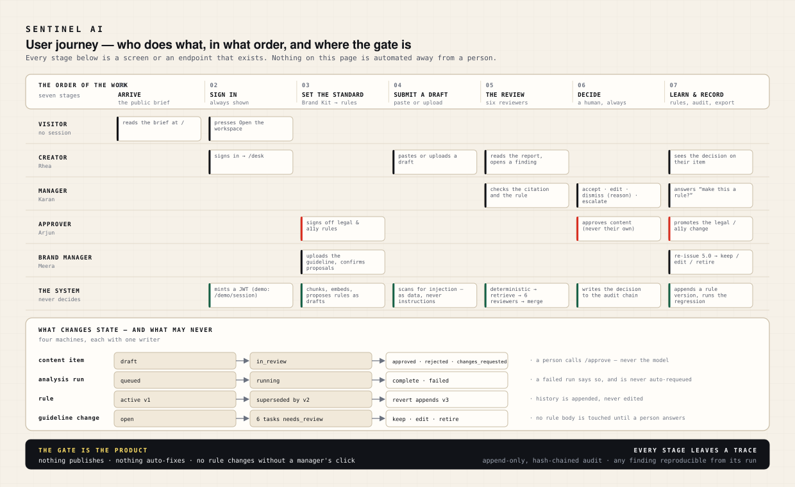

# The user journey

*Source: `docs/images/user-journey.svg` (a PNG copy sits beside it). Seven stages, five roles, and
one rule that holds at every stage: **a person decides.***

Written output is judged before it goes out, and the judgement has to be explainable, non-blocking and
reversible. So the journey is short and deliberate: **arrive → sign in → set the standard → submit →
review → decide → learn.** There are only two roles in the product that matter — the person who wrote
the draft and the person accountable for it — and everything else is machinery that serves them.

---

## Stage by stage

### 01 · Arrive — the brief

**Who:** anyone with the link. **Where:** `/` (`app/page.tsx`).

The front door is public and static. It says what the committee is, how one review reads, and what the
product refuses to do — **no session, no form, no bounce.** A visitor can read the whole thing and leave.

What they cannot do is touch a workspace: the brief reads no tenant data. If they follow a link into a
room, they are asked for a session, and the room they asked for is remembered
(`sessionStorage['sentinel.next']`) and honoured once, after sign-in.

> **Why it is not the dashboard.** Opening the product on somebody else's queue is confusing at best and
> a leak at worst. The desk is behind the door, always.

### 02 · Sign in — the step that is always shown

**Who:** anyone with an account, plus the demo's role switcher. **Where:** `/login`.

The sign-in is a **step**, not an obstacle. It renders for everybody:

* a first-time visitor gets the form;
* a browser that already holds a session gets the form **plus** *"Signed in as …"* and a
  **Continue to the desk** button — one click, never taken for them;
* the demo "View as" switcher asks `POST /v1/demo/session` for a role's token, so trying the product as a
  Creator, a Manager and an Approver needs no password at all (and that endpoint 404s in production).

Landing after sign-in is `takeNext() ?? "/desk"`.

### 03 · Set the standard — the Brand Kit and its rules

**Who:** Admin (`ananya@`) or Brand Manager (`meera@`). **Where:** `/kit`, `/rules`, `/rules/changes`.

Nothing can be judged before the standard exists. This stage is the "before you go live" work:

1. **Upload a guideline** (DOCX/PDF/TXT/image). It is extracted, chunked, embedded, and mined for
   candidate **rules, terms and facts**.
2. **Every candidate is a proposal, in draft.** `/kit` lists them; nothing is active until an Admin
   confirms it (`POST /brand-kits/{id}/confirm`) — the only path from "extracted" to "enforced".
   A new workspace is never in a state the pipeline was not written for: it ships with a draft kit, and
   `/kit` offers **Start with a sample Brand Kit** so an empty workspace can still be demonstrated.
3. **When the guideline is re-issued**, `/rules/changes` compares the new version with the one it
   replaces, section by section, and flags the rules drawn from a section that changed or vanished.
   The six flagged rules in the demo (`A11Y-001..003`, `LEG-001..003`) are shown with *the rule as it
   stands* beside *what the guideline now says* — and **every one of them is still active.**

> A new guideline does not silently rewrite your rules. It asks.

### 04 · Submit a draft

**Who:** Creator (`rhea@`, `vikram@`), External Creator (`nikhil@`), or a Manager checking their own copy.
**Where:** `/new`, or **Try your own text** on the desk.

Paste text or upload a file. The submitter chooses the content type and department, because that is what
scope means: a rule narrowed to `content_type = ad` fires on ads and nowhere else. Uploaded images are
measured at upload (dimensions, contrast inside text boxes, aspect ratio) — a measurement that did not
happen reports **"not measured"**, never a guess.

If the workspace has no Brand Kit, the API answers **409 `no_brand_kit`** and the UI offers a button to
the kit rather than the word "failed".

### 05 · The review — what happens while they wait

**Who:** the system. **Where:** `/content/{id}` — the review report.

`POST /content/{id}/analyze` returns **202** immediately; the run happens in the background, and the page
polls while it is `queued` or `running`. Six reviewers work in parallel, and one crashing does not stop
the others.

The reading order on the report is deliberate:

1. **the draft**, with every finding's span highlighted;
2. **one finding**, opened properly: *Issue → Why (rule quoted, guideline section, page) → Evidence →
   Impact → Suggestion*, with **Confirmed / Possible**, a confidence band, and the provider, model and
   prompt version that produced it;
3. **"No approved source found"** where no citation could be resolved — the system does not invent one;
4. the **provenance strip**: model, embedding model, prompt version, repeats, duplicates merged, and the
   exact rule versions applied.

### 06 · Decide — the gate

**Who:** a Manager (`karan@`, `priya@`) or an Approver (`arjun@`). **Where:** the report, `/content/{id}/approval`,
`/rules/changes`.

Four actions on a finding: **accept**, **edit**, **dismiss (reason required)**, **escalate**. Then the
content decision: **approve**, **reject**, **request changes** — and **nobody approves their own item**,
enforced in the service layer and by a Postgres trigger, not just hidden in the UI.

The forced moment in this stage is the **learning prompt**: when a manager dismisses or edits, the product
asks *"make this an approved rule?"* — **Yes / No / Yes, for one department or content type only**.
Declining is a recorded answer, not a silent no-op. Nothing is applied until that question is answered,
and **legal or accessibility rules additionally require an Approver**.

### 07 · Learn, and keep the record

**Who:** every role, differently. **Where:** `/learn`, `/rules`, `/audit`, `/analytics`, `/evaluation`,
the PDF export.

* **A promotion appends a rule version** — author, date, scope, reason. The old version is marked
  `superseded`, never deleted; `/rules` shows the history with a **Revert** that appends a copy.
* **Every promotion re-runs the labelled regression set** and flags any reviewer whose F1 drops by more
  than 0.05. That is how "it learned something" is distinguished from "it broke something".
* **`/audit`** is append-only and hash-chained: every decision, by whom, when, verifiable.
* **The report exports to PDF** — the review record a person can take to a meeting: every finding with
  its rule quote, citation, confidence and decision, and the disclaimer on every page.
* **`/analytics`** shows the measured record — Brand Score with its formula printed, the mistake mix, and
  the weeks where it got worse.

---

## The same journey in one table

| # | Stage | Who | Screen | The gate |
|---|---|---|---|---|
| 01 | Arrive | anyone | `/` | public: reads no tenant data |
| 02 | Sign in | anyone | `/login` | always shown; demo roles need no password |
| 03 | Set the standard | Admin, Brand Manager | `/kit`, `/rules`, `/rules/changes` | **a proposal is not a rule** until an Admin confirms it |
| 04 | Submit | Creator, Manager | `/new` | a workspace with no kit answers 409, not "failed" |
| 05 | Review | the system | `/content/{id}` | deterministic first; no citation → "no approved source found" |
| 06 | Decide | Manager, Approver | report, `/approval` | **a person decides**; no self-approval; legal/a11y need an Approver |
| 07 | Learn & record | everyone | `/learn`, `/audit`, `/analytics` | a version is appended, never edited; audit is hash-chained |

## Who can do what

| Role | Demo user | Submit | Decide findings | Approve content | Change rules | Analytics / audit |
|---|---|---|---|---|---|---|
| Admin | `ananya@` | ✅ | ✅ | ✅ | ✅ | ✅ |
| Brand Manager | `meera@` | ✅ | ✅ | ✅ | ✅ | ✅ |
| Approver | `arjun@` | ✅ | ✅ | ✅ (not own) | ✅ incl. legal / a11y | ✅ |
| Manager | `karan@`, `priya@` | ✅ | ✅ | ✅ (not own) | ✅ except legal / a11y | ✅ analytics |
| Creator | `rhea@`, `vikram@` | ✅ | — | — | — | — |
| External Creator | `nikhil@` | ✅ | — | — | — | — (external comments only) |

## What changes state — and what may never

Four state machines, each with exactly one writer:

| Object | States | Who may move it | What is forbidden |
|---|---|---|---|
| content item | `draft` → `in_review` → `approved` / `rejected` / `changes_requested` | a manager or approver calls `/approve` | the model never approves; nobody approves their own |
| analysis run | `queued` → `running` → `complete` / `failed` | the background task | never auto-requeued (re-running a hosted model costs money); a stale run is marked failed with an explanation |
| rule | `active v1` → `superseded by v2` → revert appends v3 | a person, through the learning prompt | no overwrite, no delete — the history *is* the audit trail |
| guideline change | `open` → 6 tasks `needs_review` → each `keep` / `edit` / `retire` | a decider (an Approver for legal / a11y) | no rule body is touched until a person answers |

## Where a first-time reader actually starts

If you are showing this to somebody for the first time, the shortest honest path is:

1. **`/`** — read the brief. It takes ninety seconds and it explains the product better than a slide.
2. **`/login`** — the demo's **View as** switcher, as **Rhea D'Souza — Creator**.
3. **`/desk`** — the dial bank and "seven weeks at the gate". Note that a figure with nothing measured
   prints "—".
4. **`/new`** — paste the three sentences from [`DEMO.md`](DEMO.md), press **Run review**.
5. **The report** — open one finding and trace the citation to the guideline, page and section.
6. **`/rules/changes`** — the re-issued guideline, six flagged rules, and the fact that **none of them
   changed.**
7. **`/audit`** — everything above, in order, hash-chained.

Steps 1–5 are the product. Step 6 is the part nobody else does. Step 7 is why you can trust 1–6.
